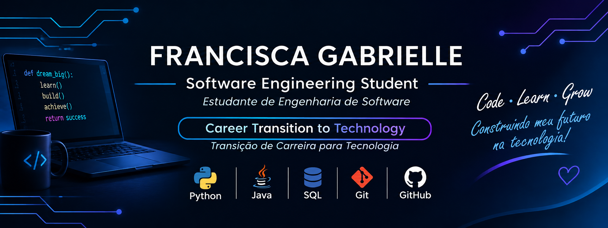

  

# Olá, eu sou Gabrielle Sousa! 👋

🎓 **Estudante do 3º semestre de Engenharia de Software | Em busca de estágio em Desenvolvimento de Software**

Sou estudante de Engenharia de Software e desenvolvo minha experiência prática por meio de projetos em Python e tecnologias web. Tenho interesse em desenvolvimento de software, interfaces responsivas, organização de código, persistência de dados e qualidade por meio de testes automatizados.

Meu objetivo é conquistar uma oportunidade de estágio em Engenharia de Software ou Desenvolvimento de Software, aplicar meus conhecimentos em um ambiente profissional e continuar evoluindo com uma equipe.

## 💻 Tecnologias e ferramentas

  
  
  
  
  
  
  
  

**Também pratico:** lógica de programação, manipulação de arquivos com `pathlib`, persistência de dados, consultas SQL, tratamento de valores monetários com `Decimal`, testes com `unittest` e integração contínua com GitHub Actions.

## 🚀 Projetos

### 1. [Sistema de Controle Financeiro](https://github.com/gabrielle-software/sistema-controle-financeiro)

Aplicação de linha de comando em Python para registrar receitas e despesas, acompanhar o saldo e gerar relatórios mensais.

- Cadastro, edição, listagem e exclusão de lançamentos.
- Persistência de dados com SQLite.
- Relatórios mensais de receitas, despesas e saldo.
- Tratamento de valores monetários com `Decimal` e armazenamento em centavos inteiros.
- Validação de dados e migração de banco legado.
- **24 testes automatizados** com `unittest`.
- Integração contínua com GitHub Actions.

**Tecnologias:** Python, SQLite, Decimal, unittest e GitHub Actions.

### 2. [Gerenciador de Tarefas em Python](https://github.com/gabrielle-software/gerenciador-de-tarefas)

Aplicação de linha de comando para organizar tarefas e praticar lógica de programação e persistência de dados.

- Cadastro, listagem, conclusão e exclusão de tarefas.
- Armazenamento de dados em arquivo JSON.
- Manipulação de arquivos e caminhos com `pathlib`.
- **7 testes automatizados** com `unittest`.
- Integração contínua com GitHub Actions.

**Tecnologias:** Python, JSON, pathlib, unittest e GitHub Actions.

### 3. [Meu Primeiro Projeto](https://github.com/gabrielle-software/meu-primeiro-projeto)

Projeto em Python para gerenciamento de clientes com armazenamento de informações em JSON.

- Cadastro e gerenciamento de dados de clientes.
- Persistência de informações em arquivo JSON.
- **21 testes automatizados** com `unittest`.
- Verificação automatizada com GitHub Actions.

**Tecnologias:** Python, JSON, unittest e GitHub Actions.

### 4. [StudyFlow — Painel de Organização de Estudos](https://github.com/gabrielle-software/painel-organizacao-estudos)

Painel web responsivo para organizar tarefas acadêmicas, acompanhar prazos e visualizar o progresso dos estudos.

- Cadastro, edição e exclusão de tarefas por matéria, prazo e prioridade.
- Marcação de tarefas concluídas e filtros por matéria e status.
- Busca por nome da tarefa ou matéria.
- Indicadores de tarefas totais, pendentes, concluídas e percentual de progresso.
- Salvamento local com `localStorage`.
- Layout adaptável para celular, tablet e computador.
- Verificação de sintaxe JavaScript e arquivos essenciais com GitHub Actions.

**Tecnologias:** HTML5, CSS3, JavaScript (ES6+) e Web Storage API.

## 📚 Atualmente estudando

- Desenvolvimento de software com Python.
- Fundamentos de Engenharia de Software.
- Desenvolvimento web com HTML5, CSS3 e JavaScript.
- Estruturas de dados e lógica de programação.
- Banco de dados e SQL.
- Testes automatizados e integração contínua.
- Boas práticas de desenvolvimento e versionamento com Git.

## 🎯 Objetivo profissional

Busco uma oportunidade de estágio em Engenharia de Software ou Desenvolvimento de Software para ampliar minha experiência prática, colaborar com equipes e contribuir para a construção e manutenção de soluções.

## 📫 Contato

- **LinkedIn:** [Gabrielle Sousa](https://www.linkedin.com/in/gabrielle-lima-895493323/)

---

# Hello, I'm Gabrielle Sousa! 👋

🎓 **Third-semester Software Engineering student | Seeking a Software Development internship**

I am a Software Engineering student building hands-on experience through Python and web development projects. I am interested in software development, responsive interfaces, code organization, data persistence, and software quality through automated testing.

My goal is to obtain a Software Engineering or Software Development internship where I can apply my knowledge, learn from a team, and continue developing my technical skills.

## 💻 Technologies & Tools

  
  
  
  
  

**Additional practice:** programming logic, file handling with `pathlib`, data persistence, SQL queries, monetary calculations with `Decimal`, automated testing with `unittest`, and continuous integration with GitHub Actions.

## 🚀 Projects

### 1. [Personal Finance Management System](https://github.com/gabrielle-software/sistema-controle-financeiro)

A Python command-line application to record income and expenses, track balances, and generate monthly reports.

- Create, edit, list, and delete transactions.
- Persistent data storage with SQLite.
- Monthly income, expense, and balance reports.
- Monetary precision using `Decimal` and integer-cent storage.
- Input validation and legacy database migration.
- **24 automated tests** using `unittest`.
- Continuous integration with GitHub Actions.

**Technologies:** Python, SQLite, Decimal, unittest, and GitHub Actions.

### 2. [Python Task Manager](https://github.com/gabrielle-software/gerenciador-de-tarefas)

A command-line application to manage tasks and practice programming logic and data persistence.

- Create, list, complete, and delete tasks.
- Store task data in JSON.
- Handle files and paths with `pathlib`.
- **7 automated tests** using `unittest`.
- Continuous integration with GitHub Actions.

**Technologies:** Python, JSON, pathlib, unittest, and GitHub Actions.

### 3. [My First Project](https://github.com/gabrielle-software/meu-primeiro-projeto)

A Python project for customer management with JSON-based data storage.

- Register and manage customer data.
- Persist information in a JSON file.
- **21 automated tests** using `unittest`.
- Automated checks with GitHub Actions.

**Technologies:** Python, JSON, unittest, and GitHub Actions.

### 4. [StudyFlow — Study Organization Dashboard](https://github.com/gabrielle-software/painel-organizacao-estudos)

A responsive web dashboard for organizing academic tasks, tracking due dates, and monitoring study progress.

- Create, edit, and delete tasks by subject, due date, and priority.
- Mark tasks as completed and filter by subject or status.
- Search by task title or subject.
- Track total, pending, completed tasks, and overall progress.
- Save data locally with `localStorage`.
- Responsive layout for mobile, tablet, and desktop.
- JavaScript syntax and essential-file checks with GitHub Actions.

**Technologies:** HTML5, CSS3, JavaScript (ES6+), and the Web Storage API.

## 📚 Currently Learning

- Python software development.
- Software Engineering fundamentals.
- Web development with HTML5, CSS3, and JavaScript.
- Data structures and programming logic.
- Databases and SQL.
- Automated testing and continuous integration.
- Software development best practices and Git version control.

## 🎯 Career Goal

I am seeking a Software Engineering or Software Development internship to gain practical experience, collaborate with a team, and contribute to building and maintaining software solutions.

## 📫 Contact

- **LinkedIn:** [Gabrielle Sousa](https://www.linkedin.com/in/gabrielle-lima-895493323/)

---

✨ *Sempre aprendendo, praticando e evoluindo.* | *Always learning, practicing, and growing.*
